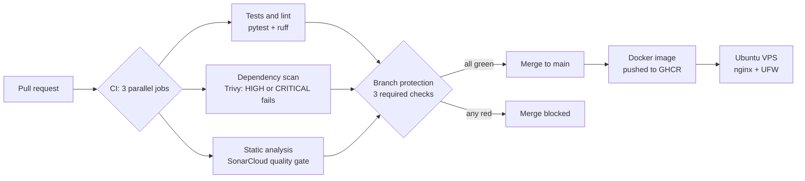

<h1 align="center">Hi, I'm Souhila Sehili 👋</h1>

  <b>Software & DevSecOps Engineer · PhD in Computer Science</b> 
  I build CI/CD pipelines that stop vulnerable code before it reaches production.

  
  
  

---

## 🧭 About me

- 🛠️ **7 years** building and integrating web applications and **REST APIs** (Python, PHP, JavaScript, Salesforce API).
- 🔐 Now focused on **DevSecOps**: shifting security left with automated tests, dependency scanning, static analysis and merge gates.
- 🎓 **PhD in Computer Science** (University of Corsica): discrete event simulation for IoT system design.
- 👩‍🏫 **Technical trainer since 2020**: I teach web development, databases and Git, and coach developers on good practices.
- ☁️ **Currently learning:** Terraform on AWS · preparing **AWS Certified Solutions Architect – Associate**.
- 💼 **Open to:** DevSecOps, DevOps and software engineering roles in **London**.

---

## 🚀 Featured project: [Secure CI/CD pipeline with automated security gates](https://github.com/SouhilaShl/tasks-api)

> **The pipeline is the project.** The FastAPI app is deliberately simple, so the focus stays on how code is tested, scanned, gated, built and deployed.

- ✅ **Nothing reaches `main` unchecked:** branch protection with 3 required status checks.
- 🧪 **Proven, not assumed:** I introduced a known HIGH vulnerability (CVE-2018-18074) and the pipeline blocked the merge.
- 🔗 **Supply-chain hardening:** every third-party action pinned to a full commit SHA; secrets in GitHub Secrets; least-privilege registry token.
- 🔍 **Real troubleshooting:** fixed a stuck required check by moving SonarCloud into the pipeline; found and fixed Docker bypassing UFW firewall rules.
- 🐳 **Deployment:** containerised API on an Ubuntu VPS behind an nginx reverse proxy, container bound to localhost only.

### 🔄 Latest commits on this project

- [Finalise README: fill placeholders, update SonarCloud CI section](https://github.com/SouhilaShl/tasks-api/commit/d5faa59f2552ca94046c40b7f654aae0de7bfda5)
- [update readme](https://github.com/SouhilaShl/tasks-api/commit/0585b91db0da2ee1d96d717a4e407d53b1a08645)
- [Add SonarCloud analysis to CI pipeline](https://github.com/SouhilaShl/tasks-api/commit/5a307a39ed28dacc21475ebb5c3e4557a3b10483)
- [Add SonarCloud project configuration](https://github.com/SouhilaShl/tasks-api/commit/3bfadc486f83d46a6fd311f9084bbf1a70fc9203)

---

## 🧰 Tech stack

**Security (DevSecOps)** 

**CI/CD** 

**Containers & Linux** 

**Cloud & IaC (learning)** 

**Development** 

**Databases** 

---

## 🧠 How I work

| Principle | In practice |
|---|---|
| **Rules, not advice** | A scan that can be ignored is a suggestion. Required checks make it a rule. |
| **Pin what you run** | A tag can be moved by its owner; a commit SHA cannot. |
| **Report and block, never auto-fix** | The pipeline stops the merge; a person understands and fixes the cause. |
| **Clean as you code** | Gates enforce quality on new code, so the codebase improves with every change. |
| **Explain it simply** | If I can teach it to a beginner, I understand it well enough to run it in production. |

---

## 💼 Experience

| Role | Where | When |
|---|---|---|
| Technical Trainer (freelance) | Training centres in Rouen and Dieppe | 2020 – present |
| Software Engineer (freelance) | Wonderlive, decentralised social network | 2025 |
| Software Engineer | Paris-Normandie, regional newspaper | 2020 – 2021 |
| Web Developer (internship) | Qwantis, start-up | 2019 |
| PhD Researcher & Teaching Assistant | University of Corsica | 2013 – 2018 |

🎓 PhD in Computer Science (2018) · Master's in Information Systems and Internet (2013) · 📄 3 papers at international conferences (SIMULTECH 2015, SIGSIM-PADS 2015)

---

  🤖 This README is rebuilt every day by a GitHub Actions workflow using <a href="https://github.com/rderik/octoprofile">octoprofile</a>, pinned to a commit SHA and running with least-privilege permissions.

