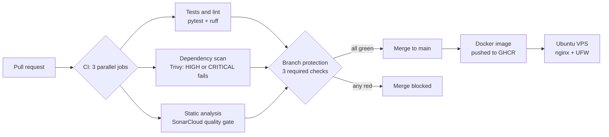

<h1 align="center">Hi, I'm Souhila Sehili 👋</h1>

  <b>Software & DevSecOps Engineer · PhD in Computer Science</b> 
  I build CI/CD pipelines that stop vulnerable code before it reaches production.

  
  

## 🧭 About me

- 🔐 Software engineer specialising in **DevSecOps**: automated tests, dependency scanning, static analysis and merge gates in CI/CD.
- 🛠️ **7 years** building and integrating web applications and **REST APIs**.
- 🎓 **PhD in Computer Science** · technical trainer since 2020.
- ☁️ Currently learning **Terraform on AWS** and preparing **AWS Solutions Architect – Associate**.

## 🚀 Featured project: [Secure CI/CD pipeline with automated security gates](https://github.com/SouhilaShl/tasks-api)

- ✅ **Nothing reaches `main` unchecked:** 3 required status checks protect the branch.
- 🧪 **Proven, not assumed:** I introduced a known HIGH vulnerability (CVE-2018-18074) and the pipeline blocked the merge.
- 🔗 **Supply chain:** every third-party action pinned to a commit SHA; secrets in GitHub Secrets; least-privilege tokens.
- 🔍 **Troubleshooting:** fixed a stuck required check, and found and fixed Docker bypassing UFW firewall rules.

## 🧰 Tech stack

 

## 🧠 How I work

| Principle | In practice |
|---|---|
| **Rules, not advice** | A scan that can be ignored is a suggestion. Required checks make it a rule. |
| **Pin what you run** | A tag can be moved by its owner; a commit SHA cannot. |
| **Block, never auto-fix** | The pipeline stops the merge; a person understands and fixes the cause. |

💬 <b>Let's connect on <a href="https://www.linkedin.com/in/souhila-sehili/">LinkedIn</a></b>

